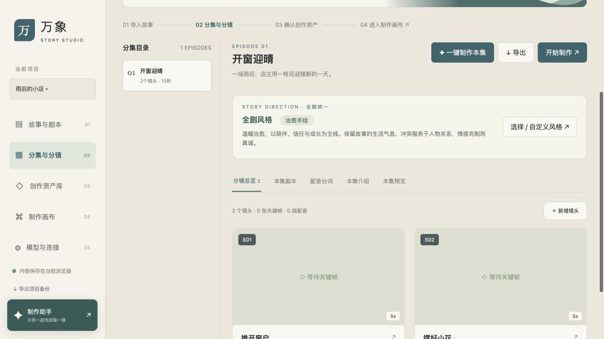
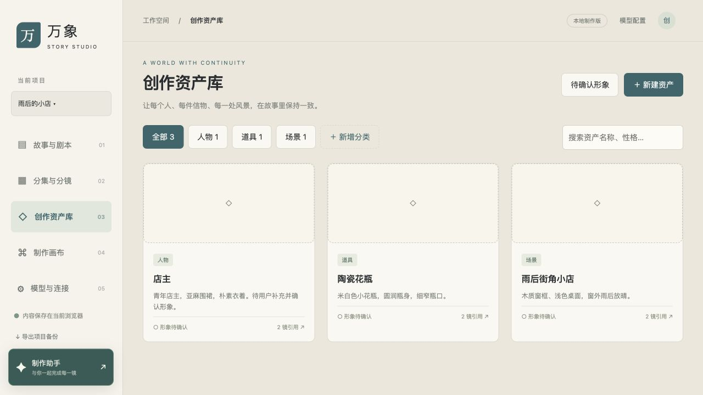
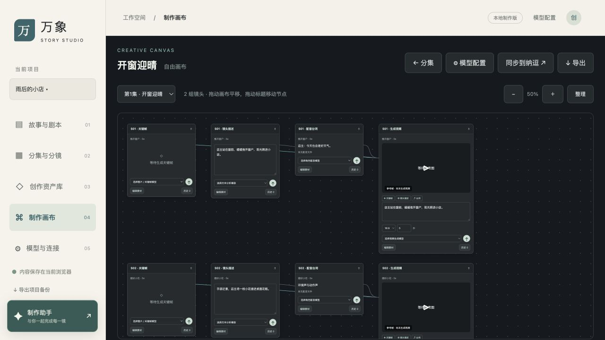

# 万象 · 漫剧制作台

一个面向小说与剧本改编的本地漫剧制作工作台，将分集、分镜、风格设定、资产确认、关键帧、配音和视频预览组织在同一条工作流中。

本项目源于个人实际创作过程，开源的重点是制作思路、交互方式与工作流实现。你可以把它当作自己的漫剧制作工具起点，根据题材、模型服务和习惯继续修改。

**这是需要自行配置和改造的工作流原型。** 它不附带模型 API、平台积分或现成的自动出片服务；生成效果取决于所接入的模型、提示词、参考素材与人工审核。

## 界面预览

以下为公开版“雨后的小店”虚构示例的实际界面。关键帧、角色形象、配音和视频尚未生成，需自行配置模型或导入素材。

### 分集与分镜

按集整理镜头，统一全剧风格，查看镜头描述、台词与本集预览。



### 创作资产库

集中管理人物、道具和场景，支持自定义分类、形象确认以及镜头引用。



### 制作画布

把关键帧、镜头描述、配音和视频组织成相连的节点，按节点选择模型和安排生成。



## 制作流程

导入小说或剧本 → 检查分集 → 定义全剧风格 → 规划分镜与资产 → 确认新形象 → 生成关键帧与配音 → 进入制作画布 → 生成或回传视频 → 逐镜和整集预览。

### 人工确认是流程的一部分

新人物、新妆造和年龄变化先进入待确认队列。用户确认后，资产进入创作资产库，后续镜头继续生成。角色配音需要配置并确认声音映射，不会随机替换音色。

自动化负责组织任务，人负责决定形象、表演和最终效果。

## 可以做什么

- **故事与剧本**：导入 TXT / Markdown 或粘贴文本，按标题或篇幅预览分集，编辑每集剧本。
- **全剧风格**：选择预设，或自定义剧情基调、画面风格、叙事节奏与避免事项，带入后续生成。
- **分集与分镜**：查看和编辑镜头描述、提示词、时长、台词与介绍；启动本集制作流程。
- **创作资产库**：管理人物、道具和场景，维护性格、小传、参考图及声音记录；支持自定义分类和分类删除时迁移资产。
- **制作画布**：用关键帧、描述、配音和视频节点组织每个镜头，选择模型、发起生成、查询历史版本。
- **对话助手**：通过自行配置的文本模型，结合当前项目上下文讨论制作方案。对话不能替代人工确认。
- **本集预览**：观看已接入的整集视频或逐镜视频，查看对应台词；支持串播当前画布已有的视频。串播不等于导出合成影片。
- **模型与连接**：提供 OpenAI 兼容接口、自定义 HTTP JSON 接口，以及纳逗官方 CLI 的接入代码。

## 开始使用

### 1. 准备环境

本地服务使用 Python 3.10 或以上版本和标准库，前端为 HTML、CSS、JavaScript，无需前端构建步骤。当前主要在 macOS 上验证，其他系统需要自行检查启动方式和可选服务适配。

下载并解压仓库，或通过 Git 克隆到本机。进入含有 `server.py` 的项目目录后运行：

```bash
python3 server.py
```

启动成功后，保持服务运行，在**同一台电脑**的浏览器中打开：

```text
http://127.0.0.1:8765/
```

这是使用者自己电脑上的本地访问地址，不是公开网站。需要先下载项目并在本机启动服务；仅打开 GitHub 仓库无法直接使用工作台。

macOS 也可使用仓库中的 `打开工作台.command`。保持服务进程运行；普通静态文件服务器无法提供模型与任务接口。

### 2. 换成自己的故事

进入“故事与剧本”，上传小说或剧本。检查分集后再导入，并设置整部剧的风格。

初次使用建议选择一小段剧本，先验证少量镜头，再扩大制作范围。开源版本的示例仅用于理解页面和数据结构，需要替换为你有权使用的素材。

### 3. 配置模型

在“模型与连接”中分别添加文本、图片、配音和视频服务，并选择默认模型。

- **文本模型**：用于剧本分析、分镜规划和助手对话。
- **图片模型**：用于资产确认图及分镜关键帧。带参考图的生成需要适配支持参考图的接口。
- **配音模型**：用于逐角色、逐句合成；人物档案需要填写真实 `voice_id` 并确认声音映射。
- **视频模型**：使用适配的自定义接口，或通过纳逗 CLI 衔接平台工作流。

自行填写服务地址、模型 ID、API Key、请求模板和结果字段。不同厂商的鉴权、参考图格式、异步任务状态及返回结构不同，不能只替换模型名称就假定可用。

“检查模型列表接口”只验证列表接口可访问，不等于完整生成已验证。模型调用和平台生成的费用由使用者自己的账号承担。

### 4. 确认资产并制作

在“分集与分镜”中点击“一键制作本集”，选择补全已有镜头或重新规划。

查看待确认形象，确认后再继续。需要修改时可上传新的候选图。后续在制作画布中调整提示词、选择模型、生成视频，再进入“本集预览”检查效果。

已有素材不会因修改全剧风格自动重做；进行中的整集任务沿用启动时的风格。页面需要保持打开，重新进入后可从制作进度继续。

### 5. 可选：连接纳逗

该接入使用纳逗官方 CLI，需要自行安装、登录并拥有可用账号与积分。它不会把平台积分转换成其他模型的 API 额度。

接入流程为：读取实际画布与模型 → 选择镜头 → 预览同步计划 → 确认上传 → 平台估价 → 确认生成 → 查询并取回视频。

目前已验证读取画布、模型目录和参数；真实上传、付费生成及视频取回仍需要在使用者环境完成联调。CLI 路径、版本和平台返回结构需要自行核对。工作台从系统 PATH 查找 `nadou`，也可在启动前用环境变量 `NADOU_CLI` 指定可执行文件的完整路径。

## 哪些地方需要自行修改

| 文件或模块 | 修改方向 |
| --- | --- |
| `dist/seed.js` | 替换初始项目、示例剧本、资产和镜头数据 |
| `dist/story-style.js` | 调整风格预设与风格描述 |
| `dist/studio.js` | 调整分镜分析提示词、确认流程、角色声音匹配及模型请求组织 |
| `server.py` | 适配服务鉴权、请求体、结果解析和异步任务轮询 |
| `nadou_bridge.py` | 适配本机 CLI 安装位置和平台命令 |
| `dist/preview-library.js` | 接入自己的已交付视频与逐镜清单 |
| `dist/app.js`、`dist/style.css` | 修改页面、资产字段与交互方式 |

项目的“一键制作”是一套可修改的任务编排实现，不保证适用于所有小说、题材和模型。建议先调整提示词、资产字段及审批规则，再用于自己的正式制作。

## 保存与备份

项目、资产、确认记录和画布保存在当前浏览器中。不同浏览器不会自动同步；清理浏览器数据前，请导出项目备份。

生成媒体、模型设置和任务回执保存在本机 `.runtime` 目录。浏览器导出的项目 JSON 不会自动包含其中的视频和音频文件，完整备份应同时保存项目 JSON 和 `.runtime`。

API Key 仅保存在服务进程内存中，服务重启后需要重新输入。模型请求会发送到你配置的服务；本地运行不代表模型推理也在本地。

请勿把密钥、登录凭据、运行记录、私人剧本、声音样本和未授权素材提交到公开仓库。

## 当前边界

这是持续迭代中的本地工作流原型。它尚不提供多人协作、云端项目同步、完整剪辑时间线或自动混音导出。画面连续性、角色一致性、对白表演与生成质量需要人工检查。

本项目分享的是一条可实践、可调整的制作路径。欢迎围绕自己的创作需求改造，并通过 Issue 或 Pull Request 交流问题和改进。

## 许可证

本项目采用 [MIT License](LICENSE)，允许使用、修改、分发和商业用途；分发软件时须保留版权及许可声明。

模型服务、第三方组件和使用者自行导入的剧本、图片、音频、视频等素材，遵循各自的许可与服务条款，不因本项目采用 MIT 而自动获得授权。
